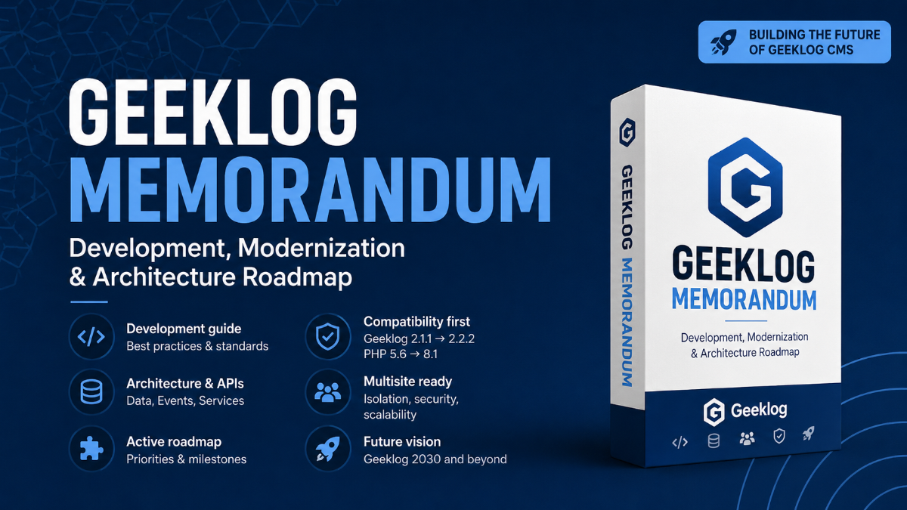

# Geeklog Development & Modernization Memorandum

Shared development standards, technical contracts and strategy for Geeklog plugins and themes.

## Binding compatibility baseline

**New and maintained work targets Geeklog 2.2.2 and later only.** Geeklog 2.1.1 and earlier are not runtime or CI targets. PHP **5.6.40** remains the minimum PHP syntax/runtime target for projects following the current cross-version policy; validate against relevant maintained PHP 8.x versions as well. Do not mistake removal of old Geeklog support for permission to drop PHP 5.6. Protect upgrades of historical persistent data, including staggered multisite installations.

The authoritative rule is [Runtime support policy](docs/policy/geeklog-runtime-support-policy.md). When another document conflicts, the policy takes precedence. Documents in `docs/history/` are records, not instructions for current compatibility work. Proposed contracts and strategies are not official Core APIs.

## Start here

- [Development guide](docs/development/plugin-development-guide.md) — implementation and release checklist.
- [Plugin API 2.2.2](docs/reference/plugin-api-reference-2.2.2.md) — minimum Core API reference.
- [Modernization roadmap](docs/strategy/geeklog-modernization-roadmap.md) — near-term priorities.
- [Documentation index](docs/README.md) — complete catalog organized by subject.

## Official Geeklog documentation

Consult the [Geeklog Core documentation repository](https://github.com/Geeklog-Core/documentation) and its [published documentation website](https://geeklog-core.github.io/documentation/) for installation, configuration, administration, development and Core API behavior.

This Memorandum supplements—not replaces—the official documentation with project-specific engineering guidelines, operational lessons and proposed plugin contracts. Verify version-specific APIs and behavior against the [Geeklog Core source](https://github.com/Geeklog-Core/geeklog/tree/v2.2.2) and release notes; drafts and unfinished migrations in the documentation repository are not guarantees of implemented Core features.

## Scope and ownership

Keep Core behavior and existing API facts separate from recommended conventions and proposed future integrations. A plugin remains responsible for its own data, ACL checks and upgrades. Shared contracts are optional design targets until implemented and verified. Never introduce Geeklog 2.1.1 shims for new work. Historical migration examples may remain available, clearly labeled.

## Repository automation

The plugin metadata audit runs via `.github/workflows/plugin-metadata.yml` and `tools/plugin_metadata.py`. These paths remain unchanged.
